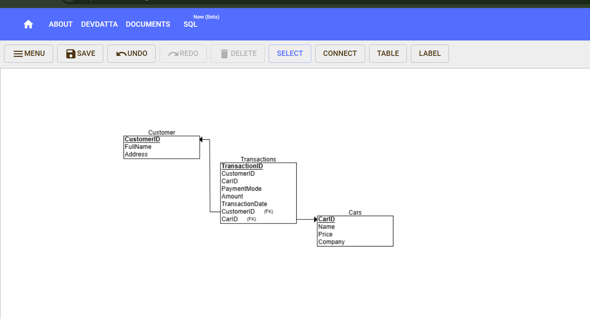
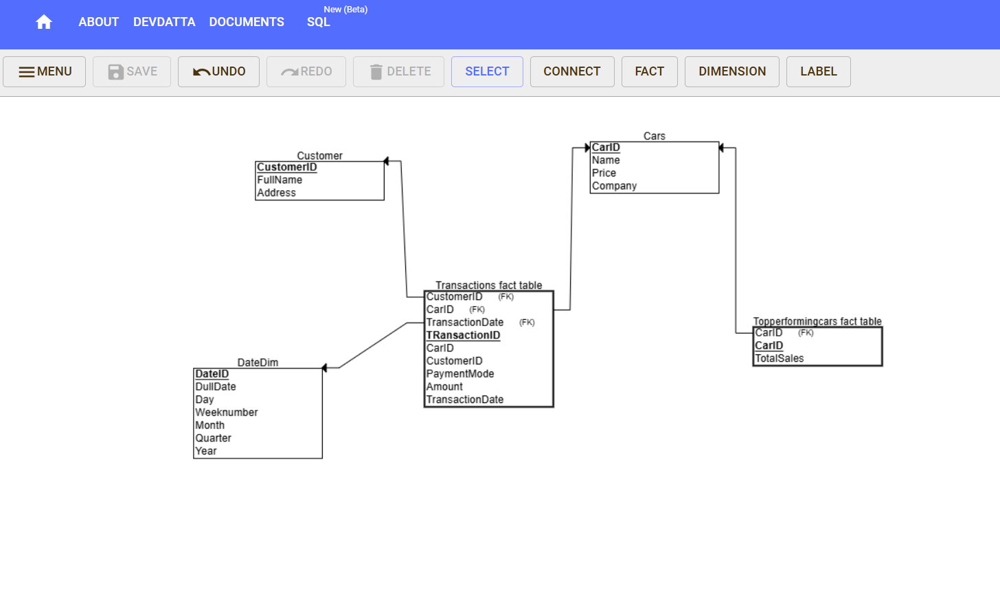

# GetACar: Car Sales OLTP → Data Warehouse Pipeline

GetACar is an end-to-end batch data pipeline for a car dealership. It has four stages:

1. **Generate** synthetic sales data with Faker.
2. **Ingest** it into a normalized MySQL operational (OLTP) database.
3. **Capture** new transactions live through a customer-facing desktop app.
4. **Load** the data into an analytical warehouse (star schema plus pre-aggregated tables) that powers a manager analytics dashboard.

> Originally built as the DATA201 Final Project (MSDA).

---

## Table of Contents

- [Architecture](#architecture)
- [Data Engineering Stack](#data-engineering-stack)
- [Project Structure](#project-structure)
- [Data Model](#data-model)
- [Pipeline Stages](#pipeline-stages)
- [Getting Started](#getting-started)
- [Applications](#applications)
- [Datasets](#datasets)
- [Roadmap](#roadmap)

---

## Architecture

```
 ┌───────────────────┐  CSV   ┌──────────────────┐ executemany ┌────────────────────────┐
 │ generate_data.py  │ ─────▶ │  load_oltp.py    │ ──────────▶ │ OLTP (datamasters_db)  │
 │ (Faker)           │        │  (pandas)        │             │ Cars·Customers·Trans.  │
 └───────────────────┘        └──────────────────┘             └──────────┬─────────────┘
                                                                          │   ▲
                                        customer_app.py (PyQt5) ──────────┼───┘
                                        live purchases                    │
                                                                          ▼
                                     02_build_warehouse.sql  (CTAS + aggregations)
                                                                          │
                                                                          ▼
                                     ┌────────────────────────────────────────────┐
                                     │ Warehouse (datamasters_wh)                 │
                                     │ Fact: Transactions                         │
                                     │ Dims: Cars · Customers · DateDim           │
                                     │ Aggs: RevenueTrends · TopPerformingCars ·  │
                                     │       TotalRevenueSummary                  │
                                     └─────────────────────┬──────────────────────┘
                                                           ▼
                                     analytics_app.py (PyQt5 + Matplotlib)
```

---

## Data Engineering Stack

| Layer | Technology | Purpose |
|---|---|---|
| Data generation | Python, Faker | Reproducible synthetic cars, customers, and transactions (seedable) |
| Processing / ETL | pandas | CSV parsing, type normalization, NULL handling |
| Ingestion | mysql-connector-python | Batched, transactional inserts (`executemany` plus rollback on failure) |
| Operational store | MySQL (`datamasters_db`) | 3NF schema with PK/FK constraints and cascading updates and deletes |
| Analytical store | MySQL (`datamasters_wh`) | Star schema: fact table, dimensions, date dimension, and aggregate tables |
| Transformation | SQL (CTAS, `GROUP BY` aggregations) | Full-refresh warehouse build, safe to re-run |
| Orchestration | `src/pipeline.py` | Runs schema → load → transform in order, with step timings |
| Config & secrets | python-dotenv, `.env` | Credentials kept out of source control |
| Data modeling | ER, relational, and star schema diagrams | Conceptual, logical, and dimensional design (`docs/`) |
| Application / BI | PyQt5, Qt Designer, Matplotlib | Transaction-capture app and analytics dashboard |

---

## Project Structure

```
getacar-data-pipeline/
├── .env.example            # Template for credentials (copy to .env)
├── .gitignore
├── requirements.txt
├── README.md
├── data/
│   ├── raw/                # Committed sample datasets
│   │   ├── cars.csv
│   │   ├── customers.csv
│   │   └── transactions.csv
│   └── generated/          # Output of generate_data.py (git-ignored)
├── sql/
│   ├── 01_oltp_schema.sql      # OLTP DDL
│   └── 02_build_warehouse.sql  # Warehouse build: dims, fact, DateDim, aggregates
├── src/
│   ├── config.py           # Paths and settings loaded from .env
│   ├── db.py               # MySQL connection helper
│   ├── generate_data.py    # Synthetic data generator
│   ├── load_oltp.py        # CSV → OLTP loader
│   ├── run_sql.py          # Runs a .sql file (with DB-name templating)
│   └── pipeline.py         # End-to-end pipeline runner
├── apps/
│   ├── customer_app.py     # GetACar: browse & buy (writes OLTP)
│   ├── analytics_app.py    # GetAnalysis: dashboard (reads warehouse)
│   └── ui/                 # Qt Designer layouts
└── docs/
    ├── er_diagram.png
    ├── relational_schema.png
    └── star_schema.png
```

---

## Data Model

### Operational database (3NF)

| Table | Columns | Keys |
|---|---|---|
| `Cars` | CarID, Name, Price, Company | PK `CarID` |
| `Customers` | CustomerID, FullName, Address | PK `CustomerID` |
| `Transactions` | TransactionID, CarID, CustomerID, PaymentMode (`ENUM`), Amount, TransactionDate | PK `TransactionID`; FK → `Cars`, `Customers` |



### Analytical warehouse (star schema)

- **Fact table:** `Transactions` (grain: one car sale), indexed on `TransactionDate` and `CarID`.
- **Dimensions:** `Cars`, `Customers`, and `DateDim` (DateID `YYYYMMDD`, FullDate, Day, WeekNumber, Month, Quarter, Year).
- **Aggregates:**

| Table | Grain | Used by |
|---|---|---|
| `RevenueTrends` | Month × Year → TotalRevenue | Revenue trend chart |
| `TopPerformingCars` | CarName → TotalSales | Top-10 cars chart |
| `TotalRevenueSummary` | Single row | Total revenue KPI |



---

## Pipeline Stages

| # | Stage | Command |
|---|---|---|
| 1 | Generate synthetic data (optional) | `python -m src.generate_data --customers 1000 --transactions 1000 --seed 42` |
| 2 | Create OLTP schema | `python -m src.run_sql sql/01_oltp_schema.sql` |
| 3 | Load CSVs → OLTP | `python -m src.load_oltp` (or `--data-dir data/generated`) |
| 4 | Build warehouse + aggregates | `python -m src.run_sql sql/02_build_warehouse.sql` |
| ★ | **All of the above** | `python -m src.pipeline` (add `--generate` for fresh data) |

The SQL files use `{{OLTP_DB}}` and `{{WAREHOUSE_DB}}` placeholders, which are filled in from `.env` at run time.

---

## Getting Started

### Prerequisites
- Python 3.10+
- MySQL 8.x with two existing databases (default names: `datamasters_db`, `datamasters_wh`)

### Setup
```bash
git clone https://github.com/Lakshmibharathy11/Car-Dealership-Sales-Analytics-Warehouse.git
cd Car-Dealership-Sales-Analytics-Warehouse

python -m venv .venv
# Windows: .venv\Scripts\activate    macOS/Linux: source .venv/bin/activate
pip install -r requirements.txt

cp .env.example .env   # then edit .env with your MySQL credentials
```

### Run
```bash
python -m src.pipeline           # build OLTP + warehouse from data/raw
python -m apps.customer_app      # customer app
python -m apps.analytics_app     # analytics dashboard
```

> Run every command from the repository root, because the modules are imported as `src.*` and `apps.*`.
> Re-run step 4 (or the whole pipeline) after new purchases to refresh the warehouse.

---

## Applications

| App | Demo login | Database | Features |
|---|---|---|---|
| **GetACar** (`apps/customer_app.py`) | `customer` / `customer123` | OLTP | Car catalog, purchase flow (customer details + payment mode) |
| **GetAnalysis** (`apps/analytics_app.py`) | `manager` / `manager123` | Warehouse | Transactions with date filter, revenue trends, top cars, total revenue |

Demo logins can be changed in `.env`.

---

## Datasets

| File | Rows | Columns |
|---|---|---|
| `data/raw/cars.csv` | 25 | CarID, Name, Price, Company |
| `data/raw/customers.csv` | 1,000 | CustomerID, FullName, Address |
| `data/raw/transactions.csv` | 1,000 | TransactionID, CarID, CustomerID, PaymentMode, Amount, TransactionDate |

All data is synthetic, generated with Faker. It contains no real personal information.

---

## Roadmap

- [ ] Docker Compose (MySQL and the pipeline in containers)
- [ ] Orchestrate with Airflow or Prefect on a schedule
- [ ] Incremental warehouse loads (watermark on `TransactionDate`) instead of full refresh
- [ ] Data quality checks (orphaned FKs, non-negative amounts, duplicates)
- [ ] Migrate transformations to dbt
- [ ] Scale test with 1M+ rows using `LOAD DATA INFILE`
- [ ] Unique customer key so the purchase flow dedupes returning customers
